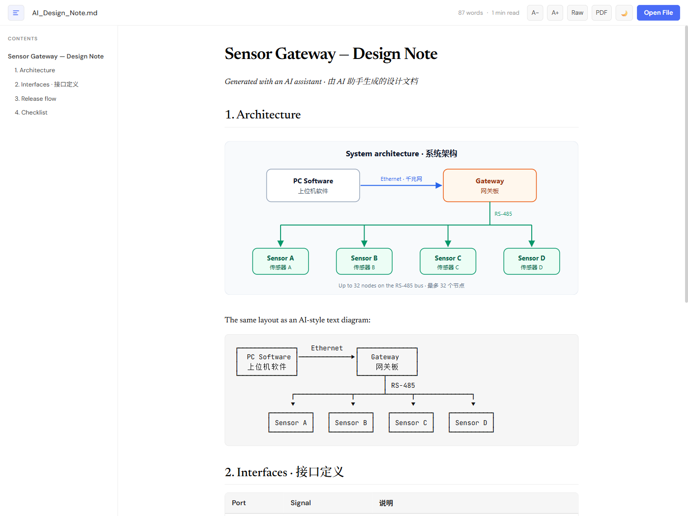
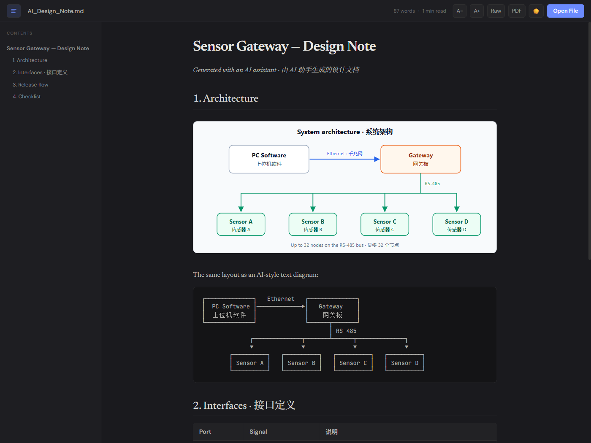

# Yang-MarkD

<p align="center">
  
</p>

<p align="center">
  <strong>专为 AI 生成文档设计的 Markdown 阅读器。</strong><br/>
  仅 3 MB 的绿色免安装软件,完整呈现 Claude、ChatGPT、Copilot 写出的方框图、表格、本地 SVG 图片和中文内容。
</p>

<p align="center">
  <a href="https://github.com/xiaojunyang0805/Yang-MarkD/releases/latest"><strong>下载</strong></a> ·
  <a href="README.md">English</a>
</p>

<p align="center">
  
</p>

## 为什么用 Yang-MarkD?

越来越多的 AI 助手直接交给你 `.md` 文件:设计说明、报告、计划书。但大多数阅读器在这些地方会出错:

- **方框字符图**(`┌─┐ │ └─┘ ▶`)错位,中文标签尤其严重。Yang-MarkD 按真正的字符网格排版,中文字符占两列,和 AI 写的时候一模一样。
- **本地图片**(如 ``)无法显示。Yang-MarkD 会按 `.md` 文件所在目录加载 SVG / PNG / JPG,无需任何服务器。
- **中英文混排**和表格显示清晰整齐。

它只做一件事:**阅读,而不是编辑**。双击 `.md` 文件即可打开。

## 下载

前往 [**Releases 页面**](https://github.com/xiaojunyang0805/Yang-MarkD/releases/latest) 下载。

### Windows

**绿色版(免安装):**

1. 下载 **Yang-MarkD_1.0.4_x64_portable.zip**(3 MB)
2. 解压,得到 `Yang-MarkD` 文件夹
3. 双击 **`yang-markd.exe`** 运行

**安装版:** 下载 **Yang-MarkD_1.0.4_x64_en-US.msi**,安装后可关联 `.md` 文件。

> 需要 Windows 10/11(x64)及 WebView2(新版 Windows 已自带)。
>
> **提示"Windows 已保护你的电脑"?** 软件暂未进行代码签名,首次运行时 SmartScreen 可能会拦截。点击 **更多信息 → 仍要运行** 即可。全部源代码都在本仓库,每个版本都由此构建。

### Linux

| 格式 | 文件 |
|------|------|
| AppImage(免安装) | `Yang-MarkD_1.0.4_amd64.AppImage` |
| Debian / Ubuntu | `Yang-MarkD_1.0.4_amd64.deb` |
| Fedora / RHEL | `Yang-MarkD-1.0.4-1.x86_64.rpm` |

AppImage 需先添加执行权限:
```bash
chmod +x Yang-MarkD_*.AppImage
./Yang-MarkD_*.AppImage
```

> 需要带 WebKitGTK 4.1 的发行版(Ubuntu 22.04+、Fedora 36+ 等)。

## 功能

- **方框字符图**按固定字符网格渲染(支持中文双宽字符)
- **本地图片**(SVG、PNG、JPG、GIF、WebP)按 Markdown 文件相对路径加载
- **拖放**或通过系统对话框打开 `.md` 文件
- **文件关联**:设为 `.md` 默认打开方式后双击即可打开
- **浅色 / 深色**主题
- **目录侧栏**,点击标题快速跳转
- **字号调节**(12–24px)
- **源码 / 渲染**视图切换
- **导出 PDF**
- **字数统计**和预计阅读时间
- 完整支持 GFM:表格、任务列表、代码块、删除线
- 外部链接在系统浏览器中打开

可以用示例文档体验:[`docs/demo/AI_Design_Note.md`](docs/demo/AI_Design_Note.md)。

## 截图

| 浅色 | 深色 |
|------|------|
|  |  |

## 开发

构建与开发说明见 [英文 README](README.md#development)。

## 许可证

[MIT](LICENSE)
