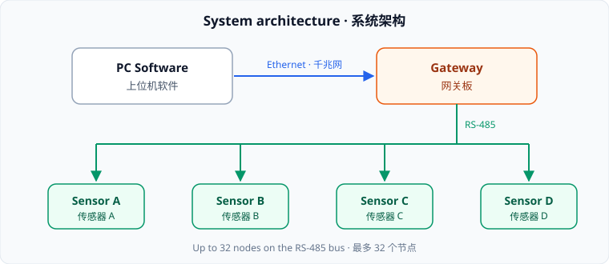

# Sensor Gateway — Design Note

*Generated with an AI assistant · 由 AI 助手生成的设计文档*

## 1. Architecture



The same layout as an AI-style text diagram:

```
┌──────────────┐   Ethernet   ┌──────────────┐
│  PC Software │─────────────▶│   Gateway    │
│  上位机软件  │              │    网关板    │
└──────────────┘              └──────┬───────┘
                                     │ RS-485
              ┌──────────────┬───────┴──────┬──────────────┐
              ▼              ▼              ▼              ▼
        ┌──────────┐   ┌──────────┐   ┌──────────┐   ┌──────────┐
        │ Sensor A │   │ Sensor B │   │ Sensor C │   │ Sensor D │
        └──────────┘   └──────────┘   └──────────┘   └──────────┘
```

## 2. Interfaces · 接口定义

| Port | Signal | 说明 |
|------|--------|------|
| J1 | 24 V DC | 电源输入,带反接保护 |
| J2 | RS-485 | 传感器总线,最多 32 个节点 |
| J3 | Ethernet | 千兆网口,连接上位机 |

## 3. Release flow


## 4. Checklist

- [x] Schematic review · 原理图评审
- [x] Box-drawing diagrams stay aligned
- [ ] Field test · 现场测试

> **Tip:** Yang-MarkD renders diagrams, tables, local images and Chinese text exactly as the AI wrote them.
